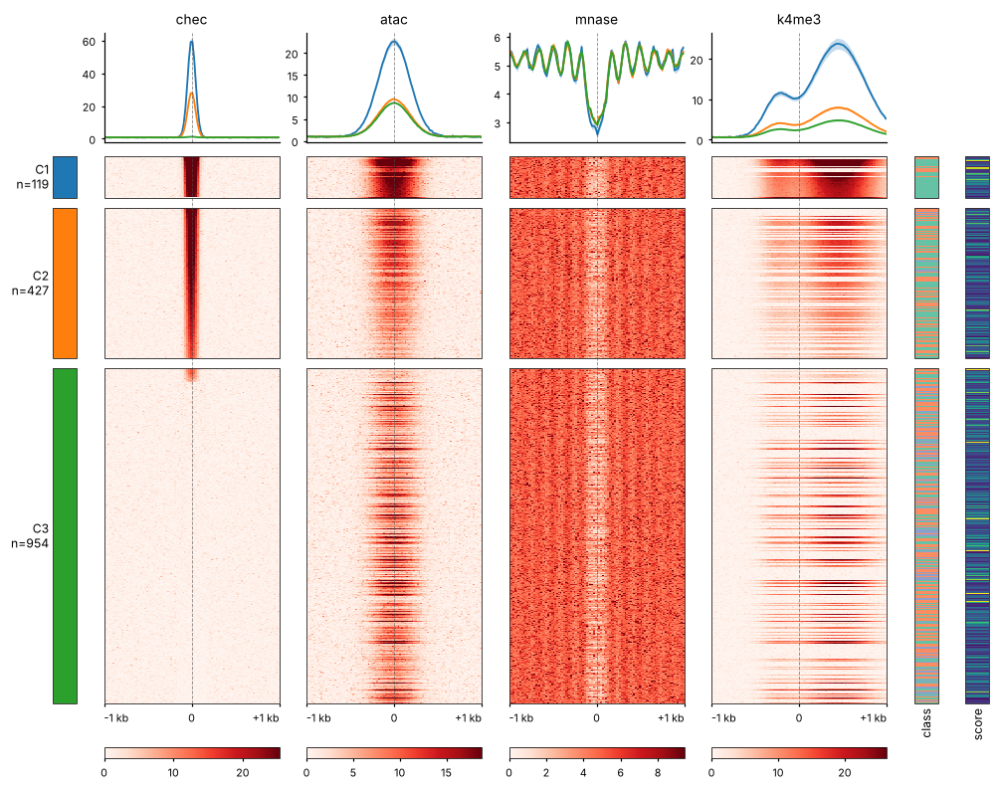

# pyenrichedheatmap

Enriched heatmaps (signal around a set of regions, one row per region) from pandas
DataFrames, drawn on matplotlib axes.

**Documentation: <https://vmindel.github.io/pyenrichedheatmap/>**

The data path is three tables. `eh.bins` turns regions into one row per bin, anchored
to each region and oriented by strand. Anything that returns one value per bin fills
it; with pymisha that is `gextract` using the bin table as both scope and iterator.
`eh.matrices` pivots the result into region x bin matrices.



```python
import pymisha as pm
import enriched_heatmap as eh

pm.gdb_init("/path/to/trackdb")
b = eh.bins(peaks, upstream=1000, downstream=1000, bin_size=20, genome=pm.gintervals_all())
vals = pm.gextract(["chec.msn2", "atac.wt"], intervals=b, iterator=b, colnames=["msn2", "atac"])
mats = eh.matrices(vals, b)

rows = eh.arrange(mats["msn2"], groups=eh.kmeans(mats, k=3))
fig, grid = eh.plot(mats, rows=rows, annotations={"class": peaks["class"]})
```

Drawing functions have the shape `fn(data, ax, rows, **style)`, so any matplotlib
layout works; `eh.plot` is built from them.

| function | draws |
|---|---|
| `eh.heatmap(mat, ax, rows)` | the matrix; rasterised body, averaged to pixel height, vector frame and ticks |
| `eh.profile(mat, ax, rows)` | average profile with an optional SEM/CI/IQR band, one line per group |
| `eh.annotation(series, ax, rows)` | per-region colour strip (categorical or numeric) or bars |
| `eh.figure(widths)` | aligned columns: profile, heatmap, colour bar |
| `eh.plot(mats, rows)` | the standard multi-column figure |

`rows = eh.arrange(by, groups=...)` fixes order and split for every panel. Matrices
and annotations are matched to it by region identifier, never by position. Sort keys
come from `eh.score`, clusters from `eh.kmeans` / `eh.hclust` or any column of your
table.

## Install

```bash
pip install git+https://github.com/vmindel/pyenrichedheatmap
pip install "pyenrichedheatmap[stats,bigwig] @ git+https://github.com/vmindel/pyenrichedheatmap"   # + scipy, scikit-learn, pyBigWig
```

Dependencies: numpy, pandas, matplotlib. pymisha is never imported by the package;
you call it.

## Claude Code skill

The package ships an Agent Skill that teaches Claude Code the data path, the pymisha
workflow and the drawing API. Install it with `pyenrichedheatmap-install-skills`; see
the [docs](https://vmindel.github.io/pyenrichedheatmap/claude-skill/).

## Development

```bash
pip install -e ".[dev]"
pytest                              # includes executing every tutorial
python docs/run_docs.py --update    # refresh tutorial output and figures
mkdocs serve
```

## License

MIT. See [LICENSE](LICENSE).
