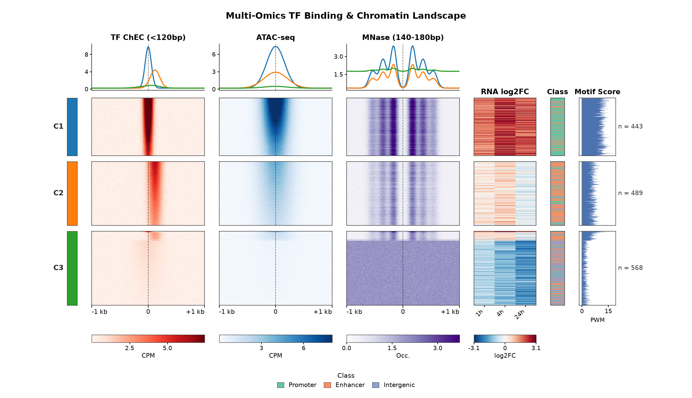

# pyenrichedheatmap

**Fast, publication-grade genomic heatmaps and horizontal multi-omics track
composition for Python**, inspired by R's
[EnrichedHeatmap](https://github.com/jokergoo/EnrichedHeatmap) and
[ComplexHeatmap](https://github.com/jokergoo/ComplexHeatmap).

```python
import enriched_heatmap as eh

hm = (
    eh.EnrichedTrack(chec, cmap="Reds", vmax_q=0.99, top_profile="mean_ci", downsample_agg="q90")
    + eh.EnrichedTrack(atac, cmap="Blues", vmax_q=0.99, top_profile="mean_sem")
    + eh.EnrichedTrack(mnase, cmap="Purples", top_profile="mean")
    + eh.MatrixTrack(rna_logfc_df, name="RNA log2FC", cmap="RdBu_r", center=0.0, width=1.1)
    + eh.CategoricalTrack(peak_class, name="Class", palette="Set2", width=0.25)
    + eh.BarTrack(motif_score, name="Motif Score", width=0.6)
)

fig = hm.plot(order_by="TF ChEC (<120bp)", split_by=3, figsize=(12.5, 7.2), raster_dpi=300)
fig.savefig("figure1.pdf", dpi=300)
```



- **Zero-desync alignment.** Every track carries a unique pandas `region_index`.
  Row ordering, filtering, and cluster splits stay synchronized across every
  horizontally composed panel.
- **Pluggable genomic loaders.** First-class support for `pyBigWig`, `pymisha`
  (including arbitrary expressions & virtual tracks), NumPy/Pandas arrays, and
  plain `(values, metadata)` interchange payloads.
- **Hybrid vector/raster PDFs.** Only the heatmap matrix body is rasterized
  (with anti-aliased `mean`/`q90`/`max`/`absmax` row downsampling for 10k–100k+
  regions) while metaplots, ticks, labels, borders, legends, and colorbars stay
  100% vector for Illustrator and Inkscape.
- **Shared scales & differential heatmaps.** Group tracks onto a shared colorbar
  and synchronized top-metaplot y-axis with `scale_group`, or call
  `mut.log2_ratio(wt)` for automatic diverging `RdBu_r` + `TwoSlopeNorm` centering.
- **A [Claude Code skill](claude-skill.md)** ships with the package.

## Where next

| | |
|---|---|
| [Quick start](tutorials/quickstart.md) | `NormalizedMatrix`, `+` composition, saving vector/raster PDFs |
| [Genomic loaders](tutorials/loaders.md) | `from_bigwig`, `from_pymisha`, strand flipping, `scale_regions` |
| [Multi-omics composition](tutorials/multiomics.md) | combining `EnrichedTrack`, `MatrixTrack`, `CategoricalTrack`, `BarTrack`, `PointTrack` |
| [Differential & shared scales](tutorials/differential.md) | `log2_ratio`, `subtract`, `scale_group` shared colorbars |
| [Large-scale rendering & clustering](tutorials/large-scale.md) | smart downsampling (`mean`/`q90`/`max`/`absmax`), k-means & hierarchical splits |
| [Coming from R EnrichedHeatmap](tutorials/from-r-enrichedheatmap.md) | idiom translation table and behavioral differences |
| [Claude Code skill](claude-skill.md) | install the bundled Agent Skill for Claude Code |
| [API reference](api/matrix.md) | every public class and function |
