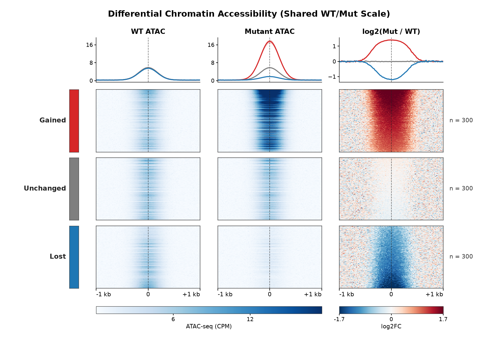

# Differential & shared-scale heatmaps

Comparing conditions (such as Mutant vs. WT ATAC-seq or ChIP vs. Input) requires
two things:

1. **Identical color & metaplot scales** on the WT and Mutant panels so visual
   intensity differences are directly comparable.
2. **A zero-centered diverging scale** (`TwoSlopeNorm`) on the differential
   panel so gained and lost signal map symmetrically to red and blue.



## Computing differential matrices

Both `.log2_ratio()` and `.subtract()` automatically align the second matrix
onto the first matrix's `region_index` and flag `metadata["is_differential"] = True`:

```python
import enriched_heatmap as eh

diff = mut.log2_ratio(wt, pseudocount=1.0)
diff.name = "log2(Mut / WT)"

# Or simple linear difference:
# diff = mut.subtract(wt)
```

When passed to `eh.EnrichedTrack(diff)`, any differential matrix automatically
defaults to `cmap="RdBu_r"` and `center=0.0` (`TwoSlopeNorm`).

## Sharing scales with `scale_group`

Assign the same `scale_group` name to tracks that should share a scale:

```python
hm = (
    eh.EnrichedTrack(wt, cmap="Blues", scale_group="ATAC-seq (CPM)", top_profile="mean_ci")
    + eh.EnrichedTrack(mut, cmap="Blues", scale_group="ATAC-seq (CPM)", top_profile="mean_ci")
    + eh.EnrichedTrack(diff, top_profile="mean_ci", colorbar_label="log2FC")
)

fig = hm.plot(
    order_by="log2(Mut / WT)",
    order_metric="center_mean",
    split_by=groups,   # ordered Categorical Series: ["Gained", "Unchanged", "Lost"]
    cluster_palette={"Gained": "#d62728", "Unchanged": "#7f7f7f", "Lost": "#1f77b4"},
    figsize=(9.5, 6.5),
    raster_dpi=300,
    title="Differential Chromatin Accessibility (Shared WT/Mut Scale)",
)
fig.savefig("differential.pdf", dpi=300)
```

Tracks in the same `scale_group` automatically share:

- a single pooled `vmin` / `vmax` normalization;
- one combined colorbar spanning contiguous columns;
- synchronized top-metaplot y-axis limits (unless overridden via `top_profile_ylim`).
