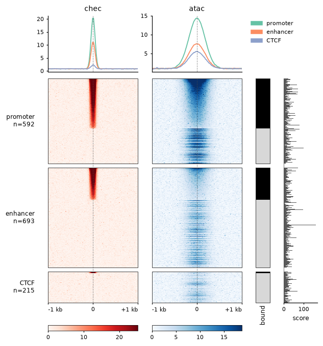
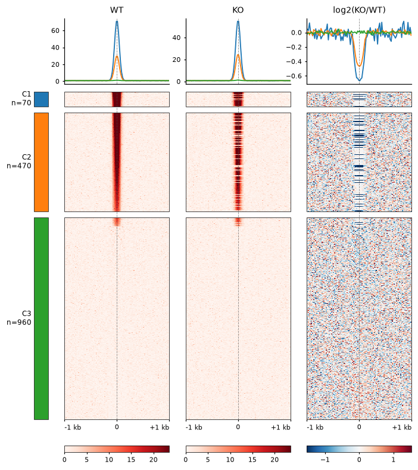
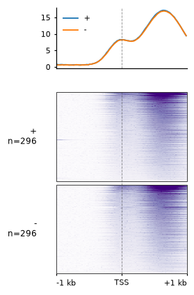
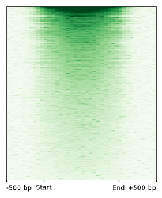

# Building figures

Figures are assembled from four drawing functions that share one signature,
`fn(data, ax, rows, **style)`:

| function | draws | returns |
|---|---|---|
| `eh.heatmap(mat, ax, rows)` | region x bin matrix | image, for a colour bar |
| `eh.profile(mat, ax, rows)` | average profile, one line per group | axes |
| `eh.annotation(series, ax, rows)` | per-region colour strip or bars | colours / image / axes |
| `eh.group_labels(ax, rows)` | group names and sizes beside the rows | |

`rows` comes from `eh.arrange` and fixes the order and split for the whole figure.
`eh.figure` makes aligned axes; `eh.plot` is a one-call layout built from the above.

```python
import matplotlib.pyplot as plt
import pandas as pd
import enriched_heatmap as eh

peaks = eh.example_peaks()
b = eh.bins(peaks, upstream=1000, downstream=1000, bin_size=20, genome=eh.example_genome())
mats = eh.matrices(eh.example_values(b, ["chec", "chec_ko", "atac", "mnase", "k4me3"]), b)
```

## Order and split

`eh.arrange(by, groups=...)` takes the sort key and the split separately, so each can
come from anywhere:

```python
by_chec = eh.arrange(mats["chec"])                                    # score a matrix
by_atac = eh.arrange(eh.score(mats["atac"], metric="max"))            # any Series of scores
by_class = eh.arrange(mats["chec"], groups=peaks["class"])            # a table column
by_kmeans = eh.arrange(mats["chec"], groups=eh.kmeans(mats, k=4))     # a clustering

tree = eh.hclust([mats["chec"], mats["atac"]], k=3)    # tree.order, tree.clusters
by_tree = eh.arrange(tree)                                            # dendrogram order

print(by_class.sizes)
```

```text
promoter    592
enhancer    693
CTCF        215
dtype: int64
```

- `eh.score` metrics: `"center_mean"` (default), `"center_max"`, `"mean"`, `"max"`,
  `"sum"`, `"median"`, `"enriched_score"` (R EnrichedHeatmap's distance-weighted
  score; flank weights stay below the middle bin on a `snap` matrix), or a function of the matrix.
- Categorical groups keep their category order (here promoter, enhancer, CTCF); other
  labels are ordered by their best-scoring row.
- `eh.kmeans(mats, k)` clusters on all matrices side by side, each z-scored as a whole
  so units do not matter; `scale="row_zscore"` clusters on shape alone.
- `eh.hclust` returns an `HClust` (`order`, `clusters`); it unpacks as
  `order, clusters = ...` and `eh.arrange(tree)` uses both. It needs memory for all
  pairwise distances, so use `eh.kmeans` beyond about 20,000 regions.
- `eh.arrange(..., index=ids)` restricts the figure to a subset of regions.

## A layout by hand

`eh.figure(widths)` returns aligned columns (sizes in inches): a profile on top, the
heatmap body, a colour bar below. Heatmaps share their y-axis and each profile shares
its x-axis with its heatmap.

```python
rows = eh.arrange(mats["chec"], groups=peaks["class"])
fig, grid = eh.figure([1.6, 1.6, 0.25, 0.6], profile=[True, True, False, False],
                      colorbar=[True, True, False, False], height=4)

for j, name in enumerate(["chec", "atac"]):
    im = eh.heatmap(mats[name], grid.heatmap[j], rows, cmap="Blues" if name == "atac" else "Reds")
    eh.profile(mats[name], grid.profile[j], rows, colors="Set2", title=name)
    eh.colorbar(im, grid.colorbar[j])

colours = eh.annotation(peaks["bound"], grid.heatmap[2], rows, colors=["0.85", "k"])
eh.annotation(peaks["score"], grid.heatmap[3], rows, kind="bar")
eh.group_labels(grid.heatmap[0], rows)
eh.legend(grid.profile[1], eh.palette(rows.labels, "Set2"), bbox_to_anchor=(1.05, 1))
```



- Profile colours follow `rows.labels`; `eh.palette(labels, colors)` gives the same
  mapping for a legend.
- `kind="bar"` draws numeric annotations as bars; the default (`kind="auto"`) picks a
  discrete colour strip for categorical/string/boolean values or a continuous strip for
  numbers, and `kind="categorical"` or `kind="numeric"` overrides that (e.g. to draw
  integer cluster codes as discrete categories).
- Any axes in `grid` is a normal matplotlib axes; add text, lines or limits as usual.

## Shared scales and differential matrices

Pass the same limits to heatmaps that should be compared; `eh.limits` computes them
over several matrices. A differential matrix (from `log2_ratio` or `subtract`) gets a
diverging scale centred on 0 without being asked:

```python
diff = mats["chec_ko"].log2_ratio(mats["chec"], pseudocount=2.0)
rows = eh.arrange(mats["chec"], groups=eh.kmeans([mats["chec"], diff], k=3))

fig, grid = eh.plot({"WT": mats["chec"], "KO": mats["chec_ko"], "log2(KO/WT)": diff},
                    rows=rows, shared=[["WT", "KO"]],
                    agg="absmax", share_profile_y=False)
```



- `shared=[["WT", "KO"]]` puts both on one colour scale aligned to `rows`; the ratio
  keeps its own. Explicit `vmin=`, `vmax=` and `center=` (a value or dict keyed by
  column name) apply to individual columns or consistently across a `shared` group.
- Differential matrices are drawn with `RdBu_r`, symmetric around 0. Pass `center=` (a
  value, or a dict by column name in `eh.plot`) for a ratio you computed yourself or a
  different midpoint, or `cmap=` to change the colours. With `center=` and only `vmin` or
  `vmax`, the other bound mirrors it around the centre.
- `agg="absmax"` keeps the strongest change, of either sign, when rows are averaged
  for display.
- `widths=` scales individual heatmap columns relative to `width` (a list in `mats`
  order or a dict keyed by column name, e.g. `widths=[1, 1, 0.5]` or
  `widths={"log2(KO/WT)": 0.6}`); profiles and colour bars follow, while annotation
  strips keep `annotation_width`.
- `annotations=` accepts a dict of `name -> Series`, a `DataFrame` (one strip per
  column) or a single `Series`, indexed by region.
  - Categorical strips take `annotation_colors=` (a palette shared and automatically
    offset across strips, or a dict keyed by strip name so each strip gets its own
    palette) and get a legend in the right margin (`annotation_legend=False` hides it).
  - Numeric strips take `annotation_cmap=`, `annotation_vmin=`, `annotation_vmax=` and
    `annotation_center=` (a value or a dict keyed by strip name) and get a colour bar
    underneath with the strip name below it (`annotation_colorbar=False` hides the bar
    and puts the name back under the strip).
- `guides=False` turns off the dashed reference lines in heatmaps and profiles.

## Strand and scale-regions

Promoter peaks are stranded in the example data, and H3K4me3 sits downstream of the
TSS. Anchored at the 5' end, the mark lines up on one side for both strands:

```python
prom = peaks[peaks["class"] == "promoter"]
tb = eh.bins(prom, upstream=1000, downstream=1000, bin_size=20, anchor="start",
             genome=eh.example_genome())
k4 = eh.matrix(eh.example_values(tb, ["k4me3"]), tb)
rows = eh.arrange(k4, groups=prom["strand"])

fig, (top, ax) = plt.subplots(2, 1, figsize=(2.2, 4.5), height_ratios=[1, 3], sharex=True)
eh.profile(k4, top, rows, legend=True)
eh.heatmap(k4, ax, rows, cmap="Purples", anchor_labels="TSS")
eh.group_labels(ax, rows)
```



In scale-regions mode the x-axis shows the flanks in bp and the body between
`Start` and `End`:

```python
sb = eh.bins(peaks, upstream=500, downstream=500, bin_size=50, body_bins=20,
             genome=eh.example_genome())
body = eh.matrix(eh.example_values(sb, ["atac"]), sb)

fig, ax = plt.subplots(figsize=(3.0, 3.5))
eh.heatmap(body, ax, eh.arrange(body), cmap="Greens")
```



## Many rows

Heatmaps with more rows than pixels are averaged down to about one row per pixel at
300 dpi before drawing (`max_rows="auto"`), which keeps PDFs small and avoids moire.
Choose the aggregation to match the data:

- `agg="mean"` for broad signal (ATAC, MNase, histone marks).
- `agg="max"` for sparse narrow peaks (ChEC, TF ChIP), so isolated hits stay visible.
- `agg="absmax"` for signed differences.
- `max_rows=None` draws every row.
