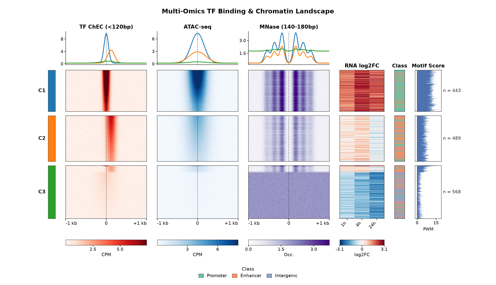

# Multi-omics horizontal composition

`pyenrichedheatmap` lets you compose heterogeneous genomic signal tracks,
expression matrices, categorical strips, barplots, and scatter tracks side by
side using `+`.



## Composing tracks with `+`

```python
import enriched_heatmap as eh

hm = (
    eh.EnrichedTrack(
        chec,
        cmap="Reds",
        vmax_q=0.99,
        top_profile="mean_ci",
        downsample_agg="q90",   # preserve narrow TF ChEC peaks
        colorbar_label="CPM",
    )
    + eh.EnrichedTrack(
        atac,
        cmap="Blues",
        vmax_q=0.99,
        top_profile="mean_sem",
        colorbar_label="CPM",
    )
    + eh.EnrichedTrack(
        mnase,
        cmap="Purples",
        vmax_q=0.99,
        top_profile="mean",
        colorbar_label="Occ.",
    )
    + eh.MatrixTrack(
        rna_df,
        name="RNA log2FC",
        cmap="RdBu_r",
        center=0.0,
        width=1.1,
        colorbar_label="log2FC",
    )
    + eh.CategoricalTrack(
        peak_class,
        name="Class",
        palette="Set2",
        width=0.25,
    )
    + eh.BarTrack(
        motif_score,
        name="Motif Score",
        width=0.65,
        xlabel="PWM",
    )
)

fig = hm.plot(
    order_by="TF ChEC (<120bp)",
    order_metric="center_mean",
    split_by=3,
    cluster_palette="tab10",
    row_gap=0.03,
    figsize=(12.5, 7.2),
    raster_dpi=300,
    title="Multi-Omics TF Binding & Chromatin Landscape",
)
fig.savefig("multiomics.pdf", dpi=300)
```

## Available track types

- **`EnrichedTrack`** — Genomic signal heatmap (`NormalizedMatrix`) with
  optional top metaplot (`"mean"`, `"median"`, `"mean_sem"`, `"mean_ci"`,
  `"mean_boot_ci"`, `"median_iqr"`, or `None`), vertical guide lines, and
  formatted bp/anchor ticks.
- **`MatrixTrack`** — Arbitrary numeric DataFrame (e.g., RNA-seq $\log_2\text{FC}$
  timepoints, TF motif scores across peaks). Supports diverging `center=0.0`
  (`TwoSlopeNorm`), optional `cluster_columns=True`, and rotated column labels.
- **`CategoricalTrack`** — Thin discrete annotation strip (e.g., Promoter /
  Enhancer / Intergenic) with a clean bottom vector legend.
- **`BarTrack`** — 1D continuous horizontal barplot (automatically switching to
  a crisp filled profile for large $N$, with optional `neg_color` for signed
  annotations).
- **`PointTrack`** — 1D continuous scatter track with optional vector running-mean
  trendline (`smooth_line=True`).

See `examples/cookbook_multiomics.py` in the repository for the complete
runnable script that generated the figure above.
