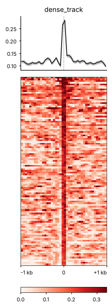

# With pymisha

<!-- requires: pymisha -->

The bin table from `eh.bins` is a misha intervals frame (`chrom, start, end` plus
extra columns), so it goes straight into `gextract` as both the scope and the
iterator. You keep full control of the extraction: any track expression, any virtual
track, several expressions in one genome pass. This page runs against pymisha's
bundled example database.

```python
import numpy as np
import pymisha as pm
import enriched_heatmap as eh

pm.gdb_init_examples()
print(pm.gtrack_ls())
```

```text
['array_track', 'dense_track', 'rects_track', 'sparse_track', 'subdir.dense_track2']
```

## Regions

Peaks from a threshold taken from the track's own distribution, not a hard-coded
number:

```python
thr = float(pm.gquantiles("dense_track", percentiles=0.99, intervals=pm.gintervals_all()).iloc[0])
peaks = pm.gscreen(f"dense_track > {thr}", intervals=pm.gintervals_all())
print(f"{len(peaks)} peaks above {thr:.2f}")
```

```text
111 peaks above 0.34
```

## Bins, then one gextract

```python
genome = pm.gintervals_all()
b = eh.bins(peaks, upstream=1000, downstream=1000, bin_size=50, genome=genome)

vals = pm.gextract(["dense_track", "np.log2(dense_track + 0.01)"], intervals=b, iterator=b,
                   colnames=["dense", "log_dense"])
print(vals.head(3))
```

```text
  chrom  start    end  dense  log_dense  intervalID
0  chr1  31625  31675   0.11  -3.058894           1
1  chr1  31675  31725   0.07  -3.643856           2
2  chr1  31725  31775   0.05  -4.058894           3
```

- `intervals=b, iterator=b` gives exactly one row per bin, with `intervalID` pointing
  back to the row of `b`. Overlapping windows are fine: each bin is its own row.
- Pass every expression to **one** `gextract` call; misha evaluates them in a single
  genome pass, and `eh.matrices` returns one matrix per column.
- `colnames=` names the columns, which become the matrix names.

```python
mats = eh.matrices(vals, b)
print(mats["dense"])
```

```text
NormalizedMatrix(shape=(111, 40), mode='reference_point', upstream=1000, downstream=1000, bin_size=50 name='dense')
```

## Virtual tracks choose the per-bin aggregation

With an interval iterator, a plain dense track gives the coverage-weighted mean of the
stored bins under each heatmap bin. For count data (ChEC, ATAC, MNase cuts) you
usually want the sum; say so with a virtual track:

```python
pm.gvtrack_create("dense_sum", "dense_track", func="sum")
pm.gvtrack_create("dense_max", "dense_track", func="max")
vals = pm.gextract(["dense_track", "dense_sum", "dense_max"], intervals=b, iterator=b)
print(vals.iloc[:3, 3:])
```

```text
   dense_track  dense_sum  dense_max  intervalID
0         0.11       0.22       0.12           1
1         0.07       0.14       0.12           2
2         0.05       0.10       0.08           3
```

Shifted views (`sshift=`/`eshift=`), PWM scores (`func="pwm"`) and distances to an
interval set (`func="distance"`) work the same way: define the virtual track, extract
it by name. Sparse tracks are NaN where nothing is stored; fill inside the expression
if zeros are meant, e.g. `"np.where(np.isnan(sparse_track), 0, sparse_track)"`.

## Do not tile with an integer iterator

`gextract(expr, intervals=windows, iterator=50)` tiles from the **chromosome start**,
not from each window's start. A window starting at 1,037 gets bins at 1,037-1,100,
1,100-1,150, ..., so bins are misaligned between regions and the first and last are
partial:

```python
import pandas as pd

w = pd.DataFrame({"chrom": ["chr1"], "start": [1037], "end": [1337]})
print(pm.gextract("dense_track", intervals=w, iterator=50)[["start", "end"]].T.to_numpy())
```

```text
[[1037 1050 1100 1150 1200 1250 1300]
 [1050 1100 1150 1200 1250 1300 1337]]
```

`eh.bins` avoids this by listing every bin; the cost is a longer interval table (20,000
regions x 200 bins is 4 million rows, which `gextract` handles in seconds).

## Stranded regions

misha interval sets carry strand as `1`/`-1`; `eh.bins` reads it directly. Here the
example annotations, anchored at their 5' ends:

```python
ann = pm.gintervals_load("annotations")
print(ann[["chrom", "start", "end", "strand"]].head(4))

tss = eh.bins(ann, upstream=500, downstream=500, bin_size=50, anchor="start", genome=genome)
around = eh.matrix(pm.gextract("dense_track", intervals=tss, iterator=tss), tss)
print(around.shape)
```

```text
  chrom  start   end  strand
0  chr1     20  2000       1
1  chr1   2500  2600       1
2  chr2     20  2000       1
3  chr2   3000  8000      -1
(8, 20)
```

Regions near a chromosome start lose their upstream bins; those cells are NaN.

## To a figure

```python
rows = eh.arrange(mats["dense"])
fig, grid = eh.plot({"dense_track": mats["dense"]}, rows=rows, band="sem", height=3.5)
```



## Coordinates and names

- misha and this package are both 0-based, half-open. Never add or subtract 1.
- `gextract` reports the database's chromosome names (`chr1` here even if the regions
  said `1`); `eh.matrices` matches by `intervalID`, so names never need to agree.
- Keep `gmultitasking` on: row order in the `gextract` output does not matter, because
  rows are placed by `intervalID`.
