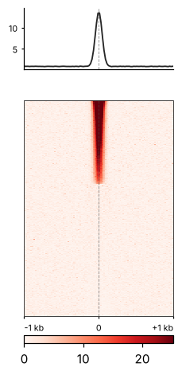
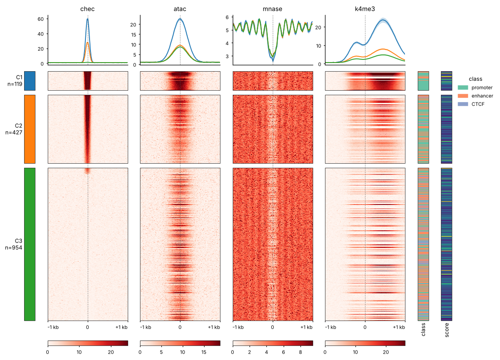

# Quick start

This page goes from a peak table to a clustered multi-track heatmap with the bundled
example data. Every step produces a plain pandas or matplotlib object you can inspect.

## The four steps

```py
b    = eh.bins(regions, upstream=1000, downstream=1000, bin_size=20)  # one row per bin
vals = pm.gextract(["chec", "atac"], intervals=b, iterator=b)         # one value per bin
mats = eh.matrices(vals, b)                                           # region x bin matrices
rows = eh.arrange(mats["chec"], groups=eh.kmeans(mats, k=3))          # order and split
```

then draw with `eh.heatmap(mat, ax, rows)`, `eh.profile(mat, ax, rows)`,
`eh.annotation(series, ax, rows)`, or all at once with `eh.plot(mats, rows)`.

`rows` is the only thing that keeps panels aligned: every drawing function takes it,
looks up regions by identifier, and lays them out top to bottom in its order.

## Example data

The package ships a toy genome with 1,500 peaks and five synthetic tracks:

```python
import enriched_heatmap as eh

peaks = eh.example_peaks()
print(peaks.head(4))
```

```text
         chrom    start      end strand     class  bound  score
name
peak0000  chr1  1601702  1602074      +  enhancer  False    7.5
peak0001  chr1    41788    42293      -  promoter  False   17.0
peak0002  chr2  1979505  1979884      +      CTCF  False   17.5
peak0003  chr1   191375   191788      +      CTCF  False    7.6
```

The index holds the peak names; they become the row identifiers of every matrix.

## Bins

`eh.bins` lays out the windows: here ±1 kb around each peak centre in 20 bp bins.
`genome=` gives chromosome sizes so bins past a chromosome end are dropped.

```python
b = eh.bins(peaks, upstream=1000, downstream=1000, bin_size=20, genome=eh.example_genome())
print(b.head(3))
print(len(b), "bins for", len(peaks), "peaks")
```

```text
  chrom    start      end    region  bin
0  chr1  1600888  1600908  peak0000    0
1  chr1  1600908  1600928  peak0000    1
2  chr1  1600928  1600948  peak0000    2
150000 bins for 1500 peaks
```

## Values

With a misha database this is `pm.gextract(tracks, intervals=b, iterator=b)` (see
[With pymisha](pymisha.md)); with bigWigs it is `eh.read_bigwig(paths, b)`. Here the
example data stands in, returning the same layout:

```python
vals = eh.example_values(b, ["chec", "atac", "mnase", "k4me3"])
print(vals.head(3))
```

```text
  chrom    start      end   chec   atac  mnase  k4me3  intervalID
0  chr1  1600888  1600908  0.314  1.095  5.016  0.635           1
1  chr1  1600908  1600928  2.542  1.645  6.369  1.859           2
2  chr1  1600928  1600948  0.036  0.532  5.899  0.485           3
```

## Matrices

`eh.matrices` pivots the long table into one matrix per value column, matching rows
to bins through `intervalID`:

```python
mats = eh.matrices(vals, b)
print(mats["chec"])
```

```text
NormalizedMatrix(shape=(1500, 100), mode='reference_point', upstream=1000, downstream=1000, bin_size=20 name='chec')
```

## A heatmap by hand

Drawing functions take a matrix, an axes and (optionally) `rows`:

```python
import matplotlib.pyplot as plt

rows = eh.arrange(mats["chec"])          # sorted by signal around the centre

fig, (top, ax) = plt.subplots(2, 1, figsize=(2.2, 5), height_ratios=[1, 4], sharex=True)
eh.profile(mats["chec"], top, rows, band="sem")
im = eh.heatmap(mats["chec"], ax, rows)
fig.colorbar(im, ax=ax, orientation="horizontal", fraction=0.04, pad=0.08)
```



- `eh.arrange(mats["chec"])` sorts rows by the mean signal within 150 bp of the anchor;
  `metric=` picks another score.
- The colour scale runs from 0 to the 99th percentile, so a handful of hot bins do not
  wash out the rest; set `vmax=` or `q=` to change it.
- The heatmap body is rasterised and everything else stays vector in PDF output.

## The standard figure

`eh.plot` builds the usual layout from the same functions: one column per matrix,
profiles on top, colour bars below, a group strip on the left and annotation strips on
the right.

```python
clusters = eh.kmeans([mats["chec"], mats["atac"]], k=3)
rows = eh.arrange(mats["chec"], groups=clusters)

fig, grid = eh.plot(mats, rows=rows, band="sem",
                    annotations={"class": peaks["class"], "score": peaks["score"]})
```



- `eh.kmeans` clusters on ChEC and ATAC jointly; clusters are numbered by mean ChEC,
  strongest first.
- Within each cluster rows are sorted by ChEC; profiles show one line per cluster.
- `peaks["class"]` and `peaks["score"]` are matched to rows by peak name, so their
  order in the table does not matter.
- Categorical annotation strips get a legend in the right margin
  (`annotation_legend=False` turns it off) and use their own palette
  (`annotation_colors=`), so a strip is not mistaken for the groups.
- `grid` holds every axes (`grid.heatmap`, `grid.profile`, `grid.colorbar`) for
  further edits.

## Saving

```py
fig.savefig("heatmap.pdf", bbox_inches="tight")
```

## Next

- [Regions to matrices](data.md): anchors, strand, scale-regions, transforms, bigWigs.
- [With pymisha](pymisha.md): track expressions and virtual tracks to matrices.
- [Building figures](figures.md): ordering, splits, custom layouts, shared scales.
- [Coming from R](from-r.md): EnrichedHeatmap and ComplexHeatmap equivalents.
